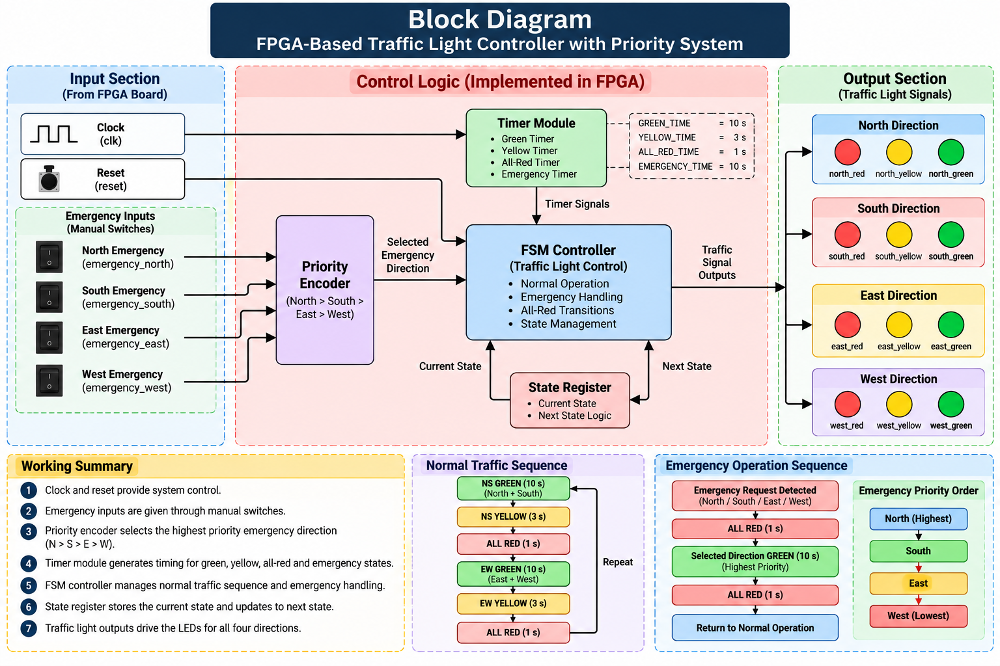
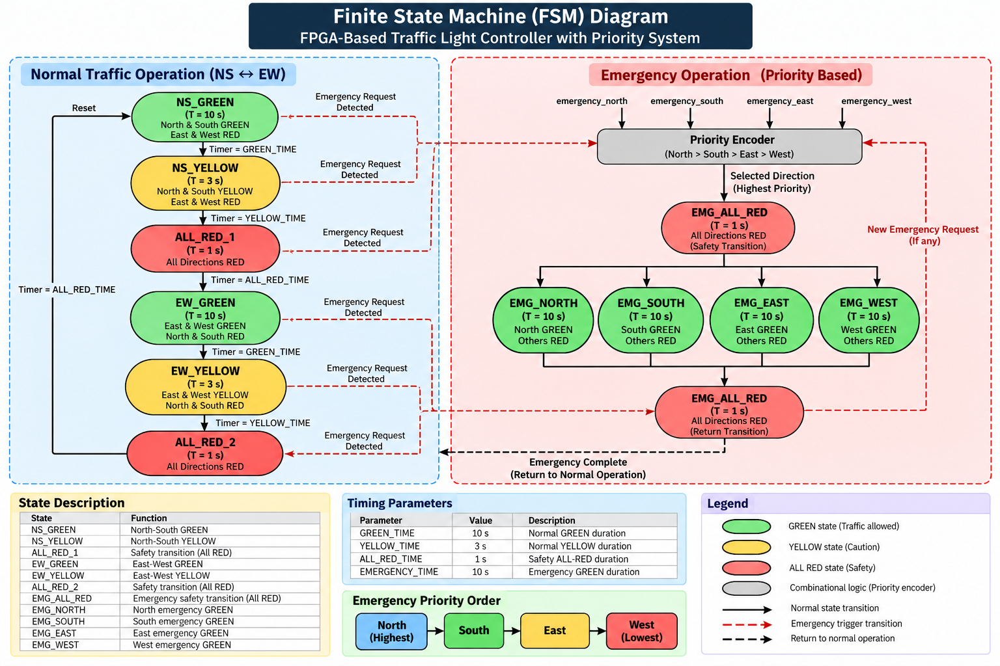
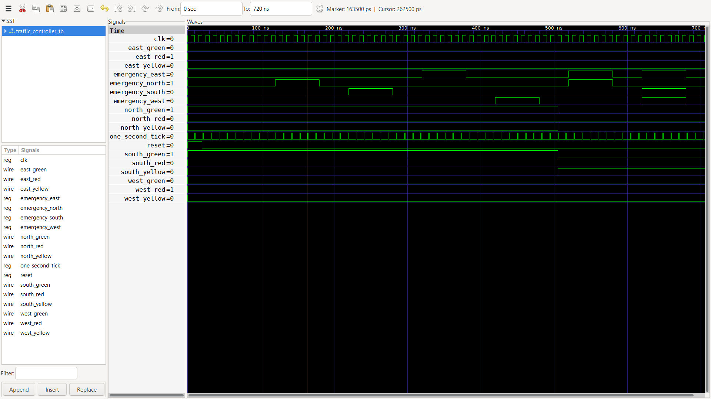
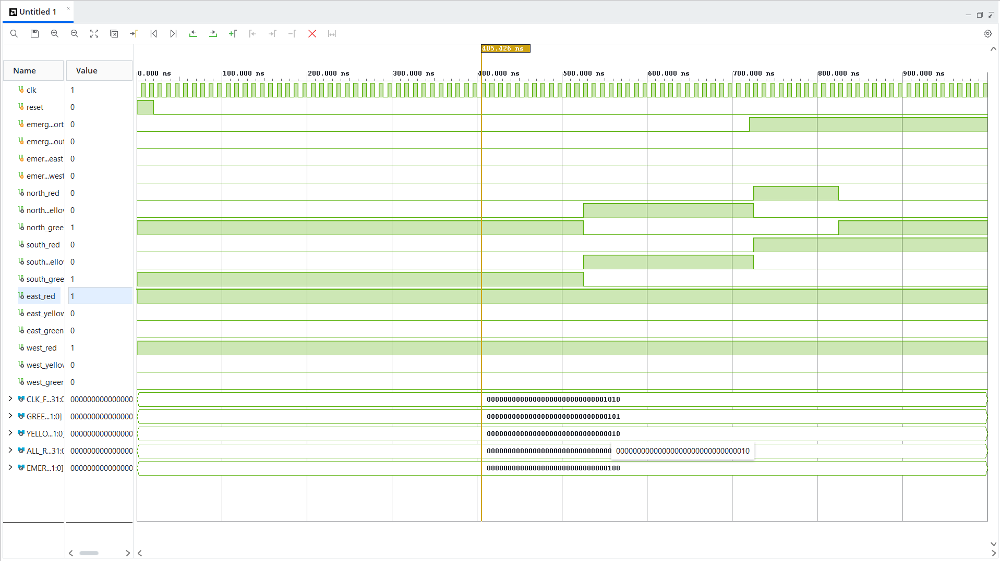
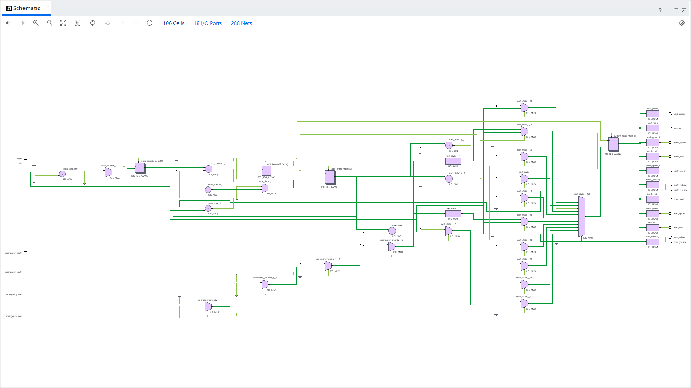
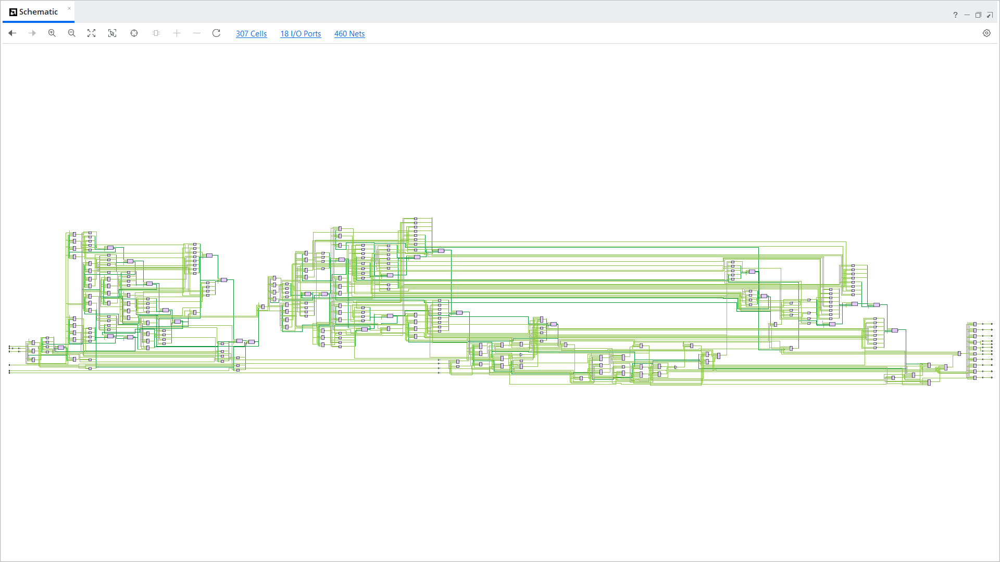
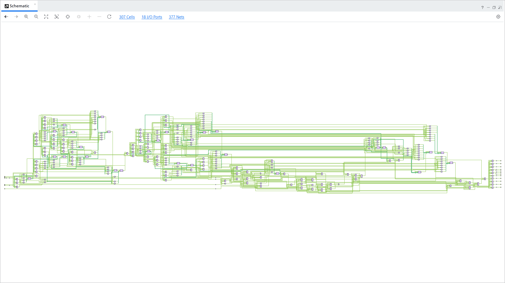
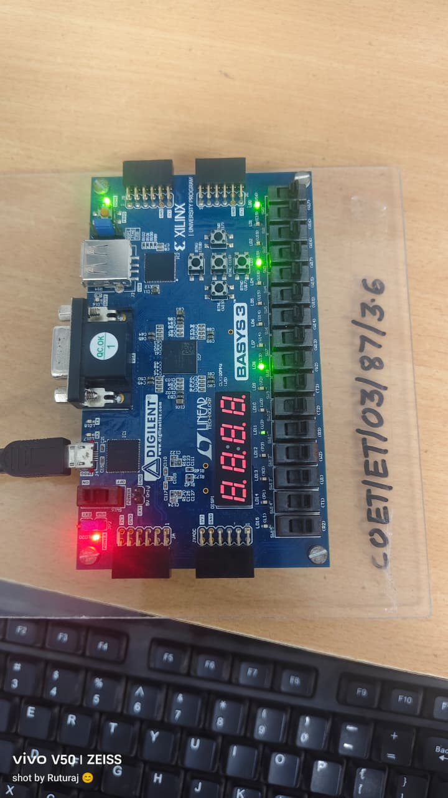
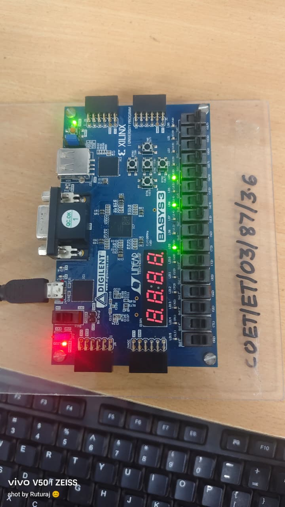
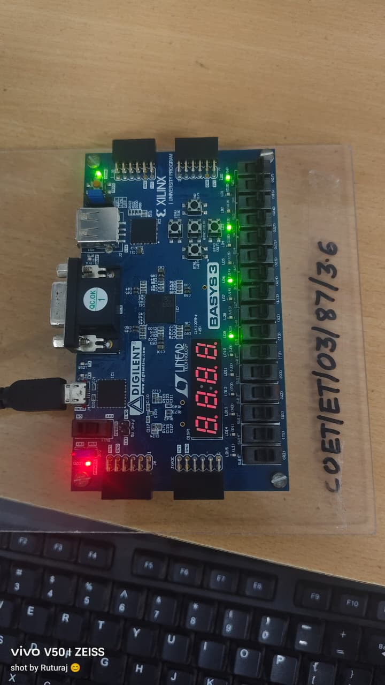

# FPGA-Based Traffic Light Controller with Priority System

A four-way traffic light controller designed using **Verilog HDL, Finite State Machine (FSM) architecture, and FPGA implementation**. The project supports normal traffic sequencing and manual emergency vehicle prioritization, targeting the **Digilent Basys 3 development board featuring the AMD/Xilinx Artix-7 FPGA**.

> **Project Status:** RTL design, simulation, Vivado design analysis, Basys 3 FPGA hardware implementation, and physical testing completed successfully.

## Table of Contents

- [Project Overview](#project-overview)
- [Objectives](#objectives)
- [Features](#features)
- [Traffic Control Sequence](#traffic-control-sequence)
- [Emergency Priority System](#emergency-priority-system)
- [System Architecture](#system-architecture)
- [Hardware and Software Requirements](#hardware-and-software-requirements)
- [Project Structure](#project-structure)
- [Simulation and Verification](#simulation-and-verification)
- [FPGA Implementation](#fpga-implementation)
- [Hardware Demonstration](#hardware-demonstration)
- [Timing Parameters](#timing-parameters)
- [Results](#results)
- [Future Improvements](#future-improvements)
- [Author](#author)
- [License](#license)

## Project Overview

The system controls traffic signals at a four-way intersection using a finite state machine implemented in Verilog HDL. It supports a predefined traffic sequence and accepts manual emergency requests for North, South, East, and West directions.

When an emergency request is handled, the controller follows an all-red safety phase before activating the selected emergency direction. If multiple emergency requests are present, the controller applies a fixed priority order.

The design was simulated and analyzed using AMD/Xilinx Vivado, implemented on the Basys 3 FPGA board, and physically tested.

## Objectives

- Design a four-way traffic light controller using Verilog HDL.
- Implement the controller using finite state machine architecture.
- Generate the normal traffic sequence with configurable timing.
- Implement manual emergency vehicle request inputs.
- Apply a fixed priority order for simultaneous emergency requests.
- Simulate and verify the RTL design.
- Perform RTL analysis, synthesis, and implementation using Vivado.
- Implement and test the design on the Digilent Basys 3 FPGA board.

## Features

- Four-way traffic signal control: North, South, East, and West.
- FSM-based traffic sequencing.
- Normal green, yellow, and all-red phases.
- Manual emergency request inputs.
- Fixed emergency priority: North > South > East > West.
- All-red safety phase before emergency green.
- Parameterized timing configuration.
- Verilog RTL design and testbench.
- Vivado simulation and design analysis.
- Basys 3 FPGA hardware implementation.
- Physical hardware testing.

## Traffic Control Sequence

During normal operation, the controller follows this repeating sequence:

| Step | North–South Signals | East–West Signals |
|---|---|---|
| 1 | Green | Red |
| 2 | Yellow | Red |
| 3 | Red | Red |
| 4 | Red | Green |
| 5 | Red | Yellow |
| 6 | Red | Red |
| 7 | Repeat | Repeat |

The all-red phase provides a safety interval between conflicting traffic movements.

## Emergency Priority System

The controller accepts four manual emergency request inputs:

- `emergency_north`
- `emergency_south`
- `emergency_east`
- `emergency_west`

The priority order is:

1. North
2. South
3. East
4. West

When an emergency request is serviced, the controller transitions through the designated all-red safety phase before granting green to the selected emergency direction. Emergency requests are handled at designated all-red transitions rather than through immediate, arbitrary preemption.

**Note:** Emergency requests are manually provided through input signals. The project does not include physical vehicle-detection sensors.

## System Architecture

The project contains the following functional modules:

- **Priority Encoder:** Determines the highest-priority emergency request.
- **Timer:** A separate timer module is included in the RTL project structure.
- **Traffic Controller:** Manages traffic states, the normal sequence, emergency handling, and signal outputs.
- **Top Module:** Connects the controller to the external clock, reset, emergency inputs, and traffic signal outputs.
- **Testbench:** Applies test inputs and observes RTL behavior during simulation.

The exact module connections and responsibilities should be verified against the current RTL source files.

### Design and Simulation Screenshots

#### Block Diagram



#### FSM Diagram



#### Simulation Waveform



#### Vivado Simulation Waveform



#### Vivado RTL Schematic



#### Vivado Synthesis Schematic



#### Vivado Implementation Schematic



## Hardware and Software Requirements

### Hardware

| Component | Specification |
|---|---|
| FPGA development board | Digilent Basys 3 |
| FPGA device | AMD/Xilinx Artix-7 XC7A35T-1CPG236C |
| Clock source | 100 MHz onboard clock |
| Traffic signal outputs | Red, yellow, and green signals for four directions |
| Emergency inputs | Four manual request signals |

### Software

| Tool | Purpose |
|---|---|
| Verilog HDL | RTL design |
| AMD/Xilinx Vivado | Simulation, synthesis, implementation, and bitstream generation |
| Icarus Verilog | Optional command-line RTL simulation |
| GTKWave | Optional waveform viewing |
| Git and GitHub | Version control and project hosting |

## Project Structure

```text
FPGA-Traffic-Light-Controller/
├── README.md
├── LICENSE
├── .gitignore
├── RTL/
│   ├── priority_encoder.v
│   ├── timer.v
│   ├── top_module.v
│   └── traffic_controller.v
├── Testbench/
│   └── traffic_controller_tb.v
├── Simulation/
│   └── final_traffic_controller.vcd
├── FPGA/
│   ├── constraints/
│   │   ├── Basys3_Traffic.xdc
│   │   └── traffic_controller_propImpl.xdc
│   ├── bitstream/
│   │   └── traffic_controller.bit
│   └── hardware/
│       ├── hardware_implementation.jpeg
│       ├── hardware_implementation01.jpeg
│       └── hardware_implementation02.jpeg
└── Documentation/
    ├── Block_Diagram.png
    ├── FSM_Diagram.png
    ├── simulation_waveform.png
    ├── vivado_simulation_waveform.png
    ├── vivado_rtl_schematic.png
    └── vivado_implementation_schematic.png
```

## Simulation and Verification

The RTL project includes a testbench for exercising the traffic controller.

### Simulating with Vivado

1. Create or open the Vivado project.
2. Add the required RTL source files.
3. Add `Testbench/traffic_controller_tb.v` as a simulation source.
4. Set the correct testbench as the simulation top.
5. Run behavioral simulation.
6. Observe traffic signals and emergency request behavior in the waveform.
7. Review the expected state transitions and timing.

### Optional Command-Line Simulation

If your testbench depends only on `traffic_controller.v`, compile it using:

```bash
iverilog -g2012 -s traffic_controller_tb -o Simulation/final_sim RTL/traffic_controller.v Testbench/traffic_controller_tb.v
```

Run the compiled simulation:

```bash
vvp Simulation/final_sim
```

If the testbench uses additional modules, include those RTL files in the compilation command. Verify the actual module dependencies before using this command.

## FPGA Implementation

The design was implemented using AMD/Xilinx Vivado and targeted to the Digilent Basys 3 FPGA board.

The implementation workflow consists of:

1. Add the RTL source files to the Vivado project.
2. Set the appropriate top module.
3. Add the Basys 3 constraint file: `FPGA/constraints/Basys3_Traffic.xdc`.
4. Run RTL analysis and synthesis.
5. Run implementation and review the design reports.
6. Generate the bitstream.
7. Program the Basys 3 board.
8. Verify the traffic signal sequence and emergency request behavior on the hardware.

The generated bitstream is stored at:

`FPGA/bitstream/traffic_controller.bit`

The main board constraint file is:

`FPGA/constraints/Basys3_Traffic.xdc`

The generated implementation constraint file is retained for reference. Use the main board constraints as appropriate for the Vivado project.

## Hardware Demonstration

The following photographs document the physical FPGA implementation.

### Hardware Implementation — Photo 1



### Hardware Implementation — Photo 2



### Hardware Implementation — Photo 3



## Timing Parameters

The intended timing configuration is:

| Parameter | Value | Description |
|---|---:|---|
| `CLK_FREQ` | 100,000,000 Hz | Input clock frequency |
| `GREEN_TIME` | 10 seconds | Normal green phase |
| `YELLOW_TIME` | 3 seconds | Normal yellow phase |
| `ALL_RED_TIME` | 1 second | All-red safety phase |
| `EMERGENCY_TIME` | 10 seconds | Emergency green phase |

These values describe the intended configuration. Verify the parameter values in the current RTL before changing the design or regenerating the bitstream.

## Results

The project covers RTL design, simulation, Vivado design analysis, FPGA implementation, and physical hardware testing of a four-way traffic light controller.

The design demonstrates normal traffic sequencing and a manual emergency request mechanism with fixed priority and an all-red safety transition.

The repository includes RTL source code, a testbench, simulation waveform, FPGA constraints, a generated bitstream, design screenshots, and hardware photographs.

## Future Improvements

- Add physical vehicle detection using suitable sensors.
- Add pedestrian crossing control.
- Introduce configurable traffic timing.
- Explore adaptive traffic sequencing based on traffic density.
- Evaluate resource utilization, maximum operating frequency, and power consumption.
- Extend the design to support additional intersections.

## Author

**Ruturaj Vyavahare**

Electronics and Telecommunication Engineering

- GitHub: [RuturajVyavahare](https://github.com/RuturajVyavahare)
- LinkedIn: [Ruturaj Vyavahare](https://www.linkedin.com/in/ruturaj-vyavahare)

## License

This project is licensed under the MIT License. See the [LICENSE](LICENSE) file for details.
